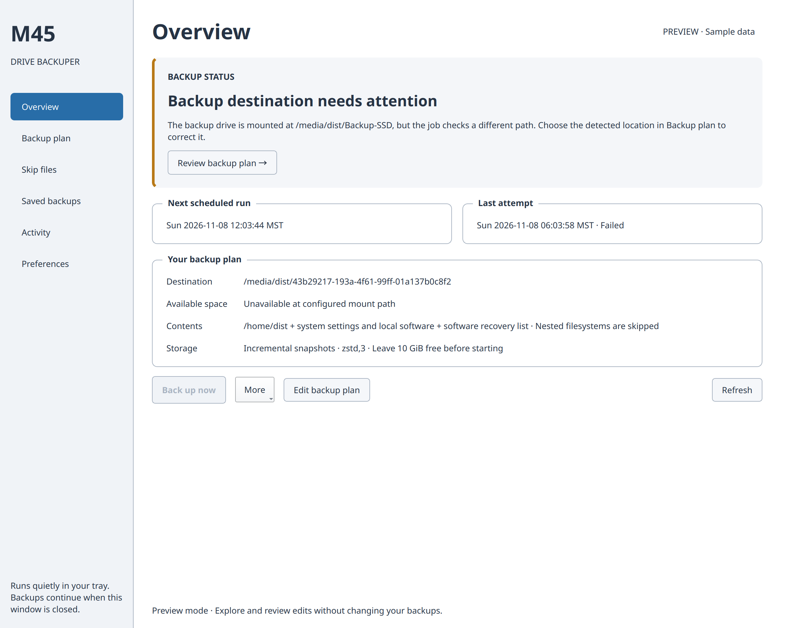
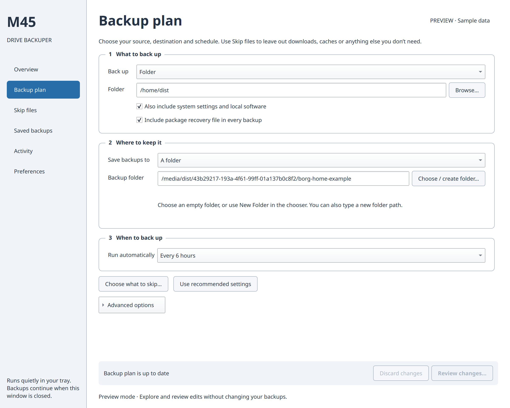
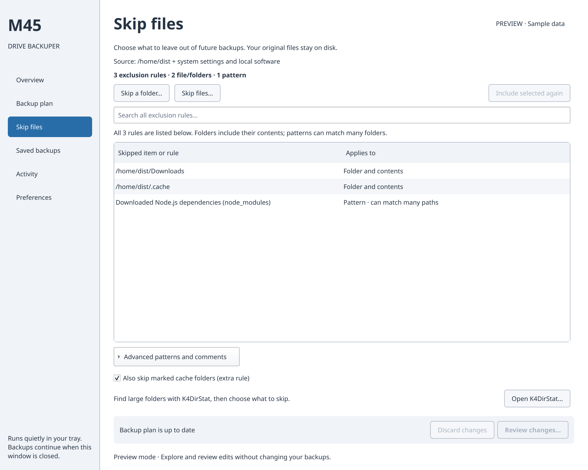
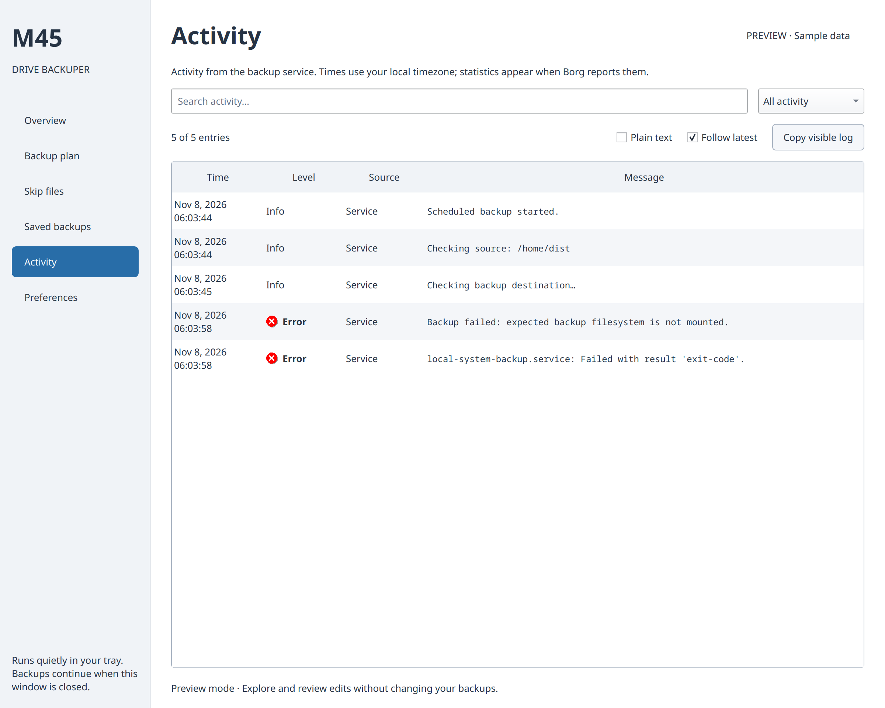
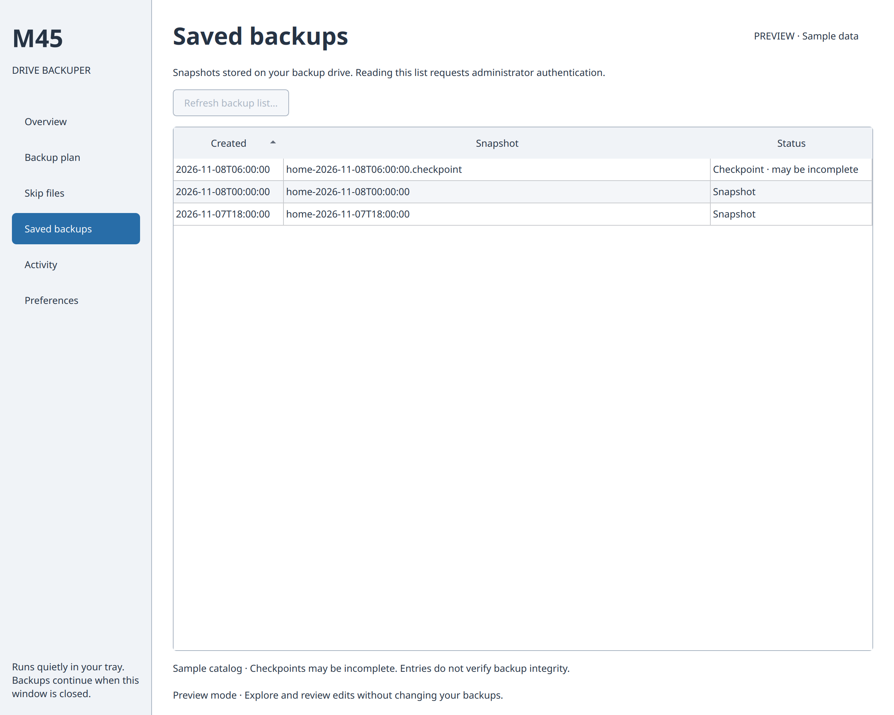
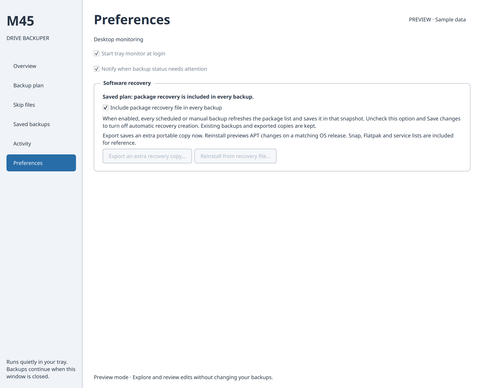
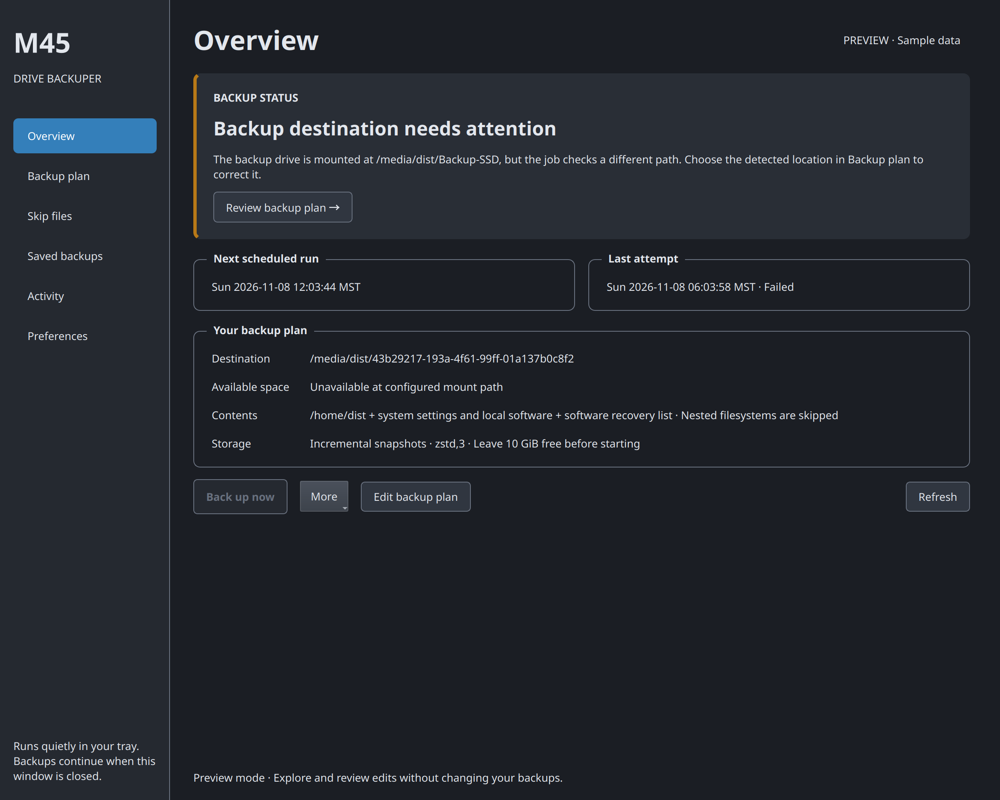
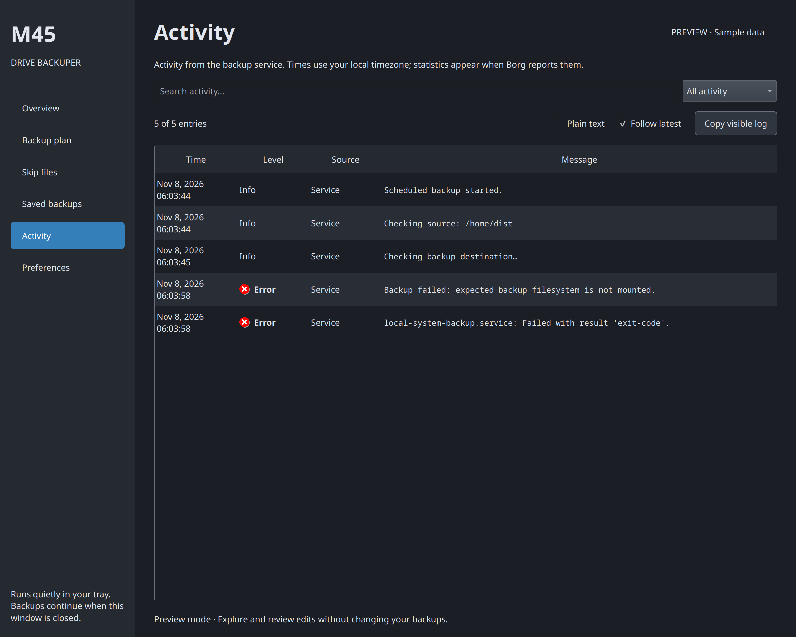

# M45 Drive Backuper

A native Qt 6 KDE Plasma tray app for configuring and monitoring this machine's existing Borg backup job. Based on the DriveWatch project's native Qt window/tray structure, palette-aware presentation, single-instance D-Bus integration, XDG launcher/autostart, CMake build and Debian packaging. DriveWatch remains unchanged; its MIT attribution is retained in LICENSE.

## Screenshots

These are captures of the actual Qt app using synthetic demo data. The destination warning demonstrates a moved backup drive, rather than the state of a real machine. Click any image to view it at full resolution.

### Everything important, at a glance

Current status and its next action come first, followed by the next scheduled run, last attempt, and saved backup plan.

[](docs/screenshots/overview.png)

| Build your backup plan | Choose what to skip |
| :--- | :--- |
| [](docs/screenshots/settings.png) | [](docs/screenshots/exclusions.png) |
| Choose your source, destination, and schedule. Advanced options stay tucked away, and edits are reviewed before saving. | Search exclusions, skip files or folders, and include selected items again. Original files stay on disk. |

### Activity you can actually read

Local timestamps, severity icons, source labels, and wrapped messages make each event easier to follow. Search, filter warnings and errors, or switch to plain text for troubleshooting.

[](docs/screenshots/activity.png)

| Browse saved backups | Desktop and recovery preferences |
| :--- | :--- |
| [](docs/screenshots/backups.png) | [](docs/screenshots/preferences.png) |
| Inspect stored snapshots and distinguish checkpoints that may be incomplete. Listing snapshots does not verify their integrity. | Set login and notification preferences, manage package recovery, or export an extra recovery copy. |

<details>
<summary><strong>See the dark theme</strong></summary>

The app follows the desktop palette. These captures show the same sample data with a dark palette.

[](docs/screenshots/overview-dark.png)

[](docs/screenshots/activity-dark.png)

</details>

## Features

- System tray status, click-to-open menu, backup shortcut, settings and journal.
- Persistent sidebar navigation keeps Overview, Backup plan, Skip files, Saved backups, Activity and Preferences in a stable order.
- Overview separates the current status and its next action from schedule, last-attempt and backup-plan details.
- Backup plan groups source, destination and schedule into three sections, with advanced options collapsed and a persistent edit/review bar.
- Native Qt controls and desktop palette colors support light and dark themes.
- Detects the existing backup filesystem at a different mount path. The user can choose its detected path and review the change before saving.
- Simple setup: choose what to back up, **A folder** or **This drive** as destination, and a schedule. Detailed options stay collapsed.
- The folder chooser supports **New Folder**, and you can type a new folder path. Drive selection shows the exact backup folder. Switching choices keeps your folder entry; drive lists refresh with status without replacing your edits.
- Incremental snapshots or a full file scan, five compression presets, a minimum free-space check and an optional repository data limit.
- A dedicated **Skip files** page: pick files or folders, search existing exclusions, and include selected items again. Comments and advanced Borg rules are preserved.
- Direct **Open K4DirStat** shortcut for finding large folders in the selected source, with installation instructions if unavailable.
- Backup mode, compression, storage limits, mounting and retention stay under Advanced. **Use recommended settings** chooses incremental snapshots, balanced compression, a 10 GiB preflight reserve, automatic mounting, system settings, software recovery lists, cache skipping and 4 hourly / 7 daily / 4 weekly / 6 monthly retention. Existing storage quotas and exclusions are preserved.
- Unsaved-change tracking, discard and review controls, and a quit warning protect unfinished edits.
- A sortable saved-backup catalog, checkpoint labels, and desktop preferences.
- Activity events with local timestamps, severity icons, source labels and wrapped messages. Search and a warnings/errors filter work across both the event table and a monospace plain-text view. Copy visible log preserves multiline output; journal access and truncation notices remain visible.
- Start a backup, enable/disable its existing timer, and read the repository archive catalog.
- Login startup toggle, attention notifications and Qt desktop colors.
- Read-only monitoring uses the desktop user's journal permissions. Administrative actions use `pkexec` with a root-owned fixed-purpose helper; the GUI never runs as root.

Opening or installing M45 Drive Backuper does **not** modify the backup script, schedule, exclusions, repository or mounts, and does not run a backup. All backup changes are explicit app actions. Settings saves show a review dialog, validate values and the destination UUID, reject changes during an active backup, save recovery copies under `/var/lib/m45-drive-backuper/settings-backups/`, and atomically replace each file. A failed save restores previous files. Schedule changes retain the existing boot trigger and randomized delay. Turning off the schedule allows an active run to finish.

This release adapts `/usr/local/sbin/local-system-backup`, `/etc/local-system-backup.exclude`, and `local-system-backup.{service,timer}`. It recognizes that script's current structure and refuses unsupported formats. The source can be a folder or a mounted filesystem; drive selections are UUID-checked again at backup time. Drives are backed up as files, not bootable disk images. Nested filesystems are skipped. The destination can be an empty local folder or a connected local drive. Drive selection uses a dedicated `M45-Backups` folder (or the existing repository on the already configured drive). Saving initializes an empty destination as an unencrypted Borg repository and marks it for this machine; unrelated nonempty folders are refused. Existing Borg repositories can be reused after verification, including a repository from a previous installation with a different machine ID; the review explains that its existing snapshots are subject to the selected retention policy. Old repositories are never deleted when switching destinations. The repository itself is excluded from backups. New repositories have owner-only access; the save review explicitly identifies their unencrypted storage. A failed settings save can leave an initialized repository ready for reuse. The app does not restore files, unlock encrypted drives, change encryption, or prune independently.

Incremental mode skips reading files that the file cache identifies as unchanged. Full file scan mode rereads every file with Borg's file cache disabled. Both create complete snapshots with deduplication; neither creates an independent disk image. Compression presets affect newly stored chunks, not existing backup data. “Skip marked cache folders” skips CACHEDIR.TAG-marked directories; explicit advanced exclusions still apply.

Storage limits are in GiB. “Leave free” is a preflight check after cleanup, not a guaranteed reserve during the backup. The storage limit controls Borg repository data, with metadata and temporary-space overhead possible; it is applied at the next backup. Choose “No limit” to remove the quota, “Keep existing limit” to preserve it, or “Limit backup storage to” for a specific cap. Settings saves show these options before requesting authentication.

## System settings and software recovery

**Also include system settings and local software** adds `/etc`, `/usr/local`, `/root`, `/var/spool/cron`, `/var/lib/dpkg`, `/var/lib/apt/extended_states`, `/var/lib/NetworkManager`, `/var/lib/bluetooth`, and `/var/lib/AccountsService` when present. These may contain passwords and private keys and inherit the selected repository’s encryption. Other data drives and service databases are outside this selection. Skip files also accepts paths in these additional sources.

**Include package recovery file in every backup** is visible in both **Backup plan** and **Preferences → Software recovery**. Both checkboxes edit the same setting; **Save changes** applies it. The saved-state message stays explicit while an enable/disable change is pending. When enabled, each backup refreshes `/var/lib/m45-drive-backuper/recovery/software-recovery.json` before archive creation. The recovery directory is included in that snapshot. The format follows the inspected M45 `restore-manifest` output convention: OS release, installed package versions, manual APT selections, held packages, Snap/Flatpak inventories, and enabled services/timers. Optional inventory failures are recorded as warnings rather than silently omitted. APT inventory failure stops the job before cleanup.

Under **Preferences → Software recovery**, **Export an extra recovery copy…** creates a separate portable JSON file. This export is optional; automatic backups already contain the recovery file when the saved setting is enabled. **Reinstall from recovery file…** validates the file and OS release/architecture, runs an APT simulation, and shows its details before administrator authentication and installation. It installs manual selections and their dependencies from the current repositories, without allowing package removals. Review repository sources and signing keys from the `/etc` backup first. Saved versions are reference information; unavailable third-party packages need their original repository or installer. Held-package, Snap, Flatpak, service and timer lists are for separate review and restoration; they are not automatically applied. The file contains inventory, not user data or package binaries. Cancellation before installation makes no package changes; a package-manager failure during installation may leave partial changes, which the app reports.

## Drive mounting and notifications

**Mount configured drives when needed** runs before source checks and backup cleanup. It uses existing `/etc/fstab` entries whose target and UUID match, verifies the UUID again after mounting, and refuses to mount over another filesystem. It supports a source folder on a recorded filesystem as well as a whole source drive. The drives must be connected, and encrypted volumes must already be unlocked. It does not create fstab entries or format disks. A new drive without a matching fstab entry can be used while mounted, but must be mounted through the desktop when disconnected. The tray’s **Mount backup drives** action also uses this path.

The tray shows running, completed, warning and error states. **Backup completed with warnings** uses an amber icon; failed attempts use a red icon and a critical notification. **Activity** shows Borg's actual warning/error messages separately from the full job output, including errors from cleanup commands. Repeated identical alerts are suppressed; a later attempt can notify again. Notifications also cover unavailable destinations or sources, low free space, disabled schedules and monitoring failures. They require the tray to be running and can be suppressed by desktop Do Not Disturb.

For an existing job, **Enable Borg warning and error reporting…** on Overview updates the saved script after authentication, preserving the selected plan. Saving any backup-plan change also installs reporting. The job uses Borg's `--log-json`, keeps warning exit status 1 and error statuses, and records a final result in the journal. Maintenance warnings allow archive creation to continue, then remain visible in the final result. Preflight failures and skipped/locked attempts are distinguished from completed backups. An existing systemd `OnFailure` alert also runs when the job exits with warnings; the app distinguishes that warning result from a fatal error. No service failure policy is changed.

Diagnostics are read only from the service's current invocation, so an earlier warning cannot contaminate a later success. The Activity view retains up to 500 journal entries and labels truncation. It preserves journal timestamps and shows them in your local timezone. Unknown timestamps are shown as a dash; plain output without an explicit severity is not guessed to be an error. The event table and plain-text view share search and severity filters; access errors remain visible even when no events match. Journal permissions/retention may limit detailed messages; the app does not claim that unavailable diagnostics prove a warning-free backup.

## Choosing what to skip

1. Choose a source folder or mounted drive in **Backup plan**.
2. Open **Skip files**. Existing exclusions are already listed, including advanced rules. The total rule count stays visible while searching, with a separate count of matching rows. Folder rules cover their contents, and a single pattern can exclude many folders. The marked-cache checkbox adds a separate rule beyond this count.
3. Use **Skip a folder…** or **Skip files…** to select unwanted data. A folder selection excludes that folder and its contents; a file selection matches that exact name, including characters such as `*` and `[`.
4. Use **Open K4DirStat…** to inspect large folders, then return to choose exclusions. K4DirStat is optional and runs as your desktop user. See the [K4DirStat manual](https://manpages.ubuntu.com/manpages/noble/man1/k4dirstat.1.html).
5. **Save changes…** shows a short plan summary and expandable technical details before authentication.

Excluding something affects future backups and does not delete the original. Removing a rule with **Include selected again** does not override other matching rules. Old snapshots retain their contents until retention removes them. A changed source can leave exclusions outside the selected source; those paths are labelled and retained. Custom rules and comments are preserved when using the pickers. Source paths through symlinks must be replaced by their resolved path so exclusion matching stays consistent.

## Build, test and install

Requires CMake, C++17, Qt 6 Widgets/DBus development packages, Python 3, Borg 1.2, systemd and PolicyKit. Python tests use the distribution Python because it supplies Borg's pattern parser.

```sh
cmake -S . -B build -G Ninja -DCMAKE_BUILD_TYPE=Release -DCMAKE_INSTALL_PREFIX=/usr -DPython3_EXECUTABLE=/usr/bin/python3
cmake --build build --parallel
ctest --test-dir build --output-on-failure
(cd build && cpack -G DEB)
sudo apt install ./build/m45-drive-backuper_0.3.4_amd64.deb
m45-drive-backuper --show
```

The package adds an Applications menu entry and login autostart. No root background collector is needed: the app reads status asynchronously every 15 seconds. Install the package to use real monitoring/actions; the helper has a fixed installed path. Members of `adm` or `systemd-journal` can read the service journal. If journal access is restricted, the app reports that limitation; status is still available. Quitting the tray monitor does not affect system backups. Existing system failure notifications remain in place.

```sh
QT_QPA_PLATFORM=offscreen ./build/m45-drive-backuper --demo --page journal --screenshot build/activity-preview.png
```

Demo mode uses synthetic data. You can edit a plan, choose exclusions and review the result; it never invokes the helper, opens K4DirStat, saves preferences, registers the real D-Bus name, or sends notifications. Screenshot timestamps illustrate the sample failure rather than the current state of a machine.

### Refreshing the README screenshots

The opt-in capture target renders all six pages plus dark Overview and Activity variants with a consistent Fusion style, Noto Sans font, local timezone, and 1200 × 960 logical window size. Use Noto Sans and your platform's normal monospace font for consistent typography. A scale factor of 2 produces sharp 2400 × 1920 PNGs for full-size viewing. The capture tool always uses demo mode and is not included in the installed app.

```sh
cmake --build build --target capture-screenshots --parallel
QT_QPA_PLATFORM=offscreen QT_SCALE_FACTOR=2 TZ=America/Denver ./build/capture-screenshots docs/screenshots
```

## Isolated backup test harness

Run this as your normal desktop user, without sudo:

```sh
/usr/bin/python3 tests/backup_harness.py
```

Each invocation creates a fresh directory under `build/backup-lab/run-*`. Existing runs are never overwritten. Use `--output /path/to/lab` to choose another parent directory. The laboratory contains a small **source files** tree, a real Borg repository at **destination/repository**, sample system settings, generated recovery JSON, a **restored** copy, generated shell scripts, per-run logs, and **REPORT.txt** / **report.json**. The sample package inventory contains fake package names; do not use it to reinstall software.

The harness uses the application's actual script adapter and recovery serializer, then executes the resulting shell job. Borg performs real creation, pruning, compaction, quota configuration, listing, extraction and `check --verify-data` operations. Checks cover selected/excluded data, changed and new files, historical snapshots, automatic recovery refresh, disabling recovery/system settings, restoring excluded data to future coverage, compression/full-scan settings, job-lock contention and early failure guards. A negative control deliberately omits recovery from an otherwise valid archive and verifies that our check catches it even when Borg's integrity check succeeds.

Mount UUIDs, free-space readings, package-manager inventory, archive timestamps and selected Borg failures/cleanup warnings are controlled test inputs. The create-warning scenario uses a genuinely unreadable sample file. No real mounts, systemd actions, authentication, package installations, installed helper calls or live backup configuration changes occur. The separate Qt tests verify Overview/Activity messages, warning versus critical notification requests, duplicate suppression and clearing old diagnostics. Desktop notification delivery and physical drive handling need separate desktop/VM checks. The shell fixture in `tests/fixtures/local-system-backup.sh` represents the supported legacy job; the actual adapter upgrades its warning handling before execution. It is never copied from a user's live job at test time.

The former warning-to-success gap is now a required regression check: Borg warning **1** must remain job warning **1**, and its message must survive parsing. Cleanup warnings/errors, fatal create errors, skipped runs and a later clean run are also checked. Every gap returns failure; `--strict` remains accepted for compatibility and is used by CTest. `--temporary` removes its run directory after reporting; omit it when you want to inspect artifacts. No data from the real backup repository is used.

## Interpretation and limitations

The service's latest result is an attempt result, not proof of a valid or recent archive. Jobs that have not yet enabled the new reporting retain their previous warning handling; Overview offers the update. The archive tab reads stored archive names/timestamps on demand with administrator authentication and a short Borg lock wait. Checkpoint archives may be incomplete. No archive integrity check or live percentage is provided in the app; the script emits statistics after its runs. Root authentication may be cancelled without changing anything.

Retention settings can delete old archives on a future backup. Copies of old settings cannot recover deleted archives. Settings files are replaced individually; rollback handles ordinary errors but cannot provide a filesystem-wide transaction across a power loss. An already-open Settings editor is not overwritten by status polling; reopen the app to load external edits before saving.

Remove with `sudo apt remove m45-drive-backuper`, then quit the tray monitor. This preserves the existing backup system and per-user startup/preferences.

Implementation references: [Qt system tray](https://doc.qt.io/qt-6/qsystemtrayicon.html), [Borg archive listing](https://borgbackup.readthedocs.io/en/1.2.8/usage/list.html).
