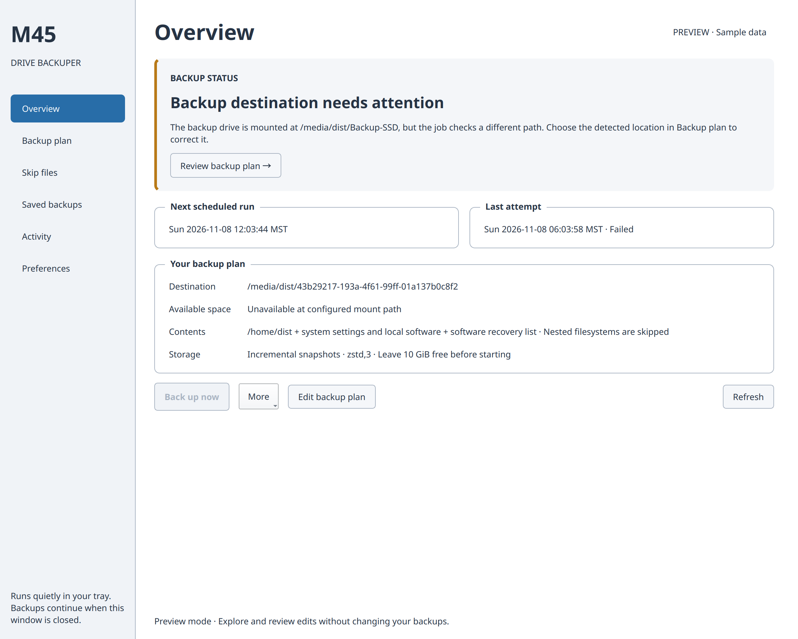
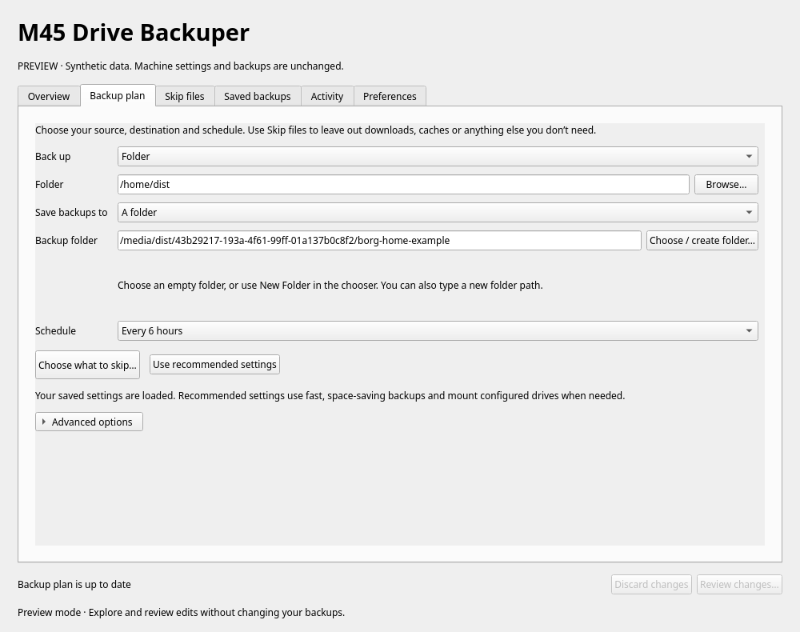
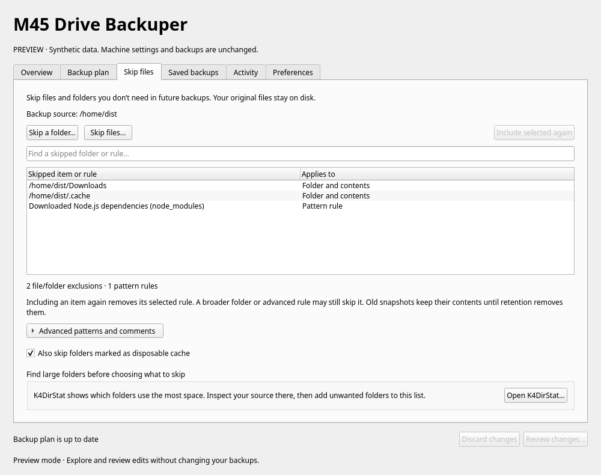
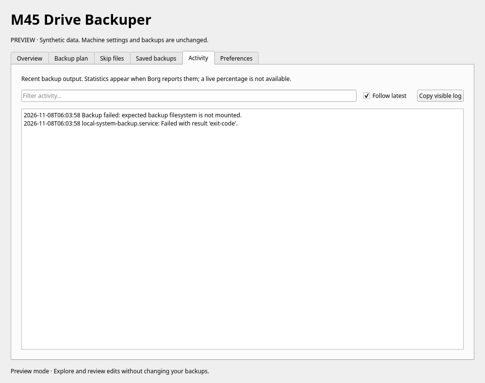
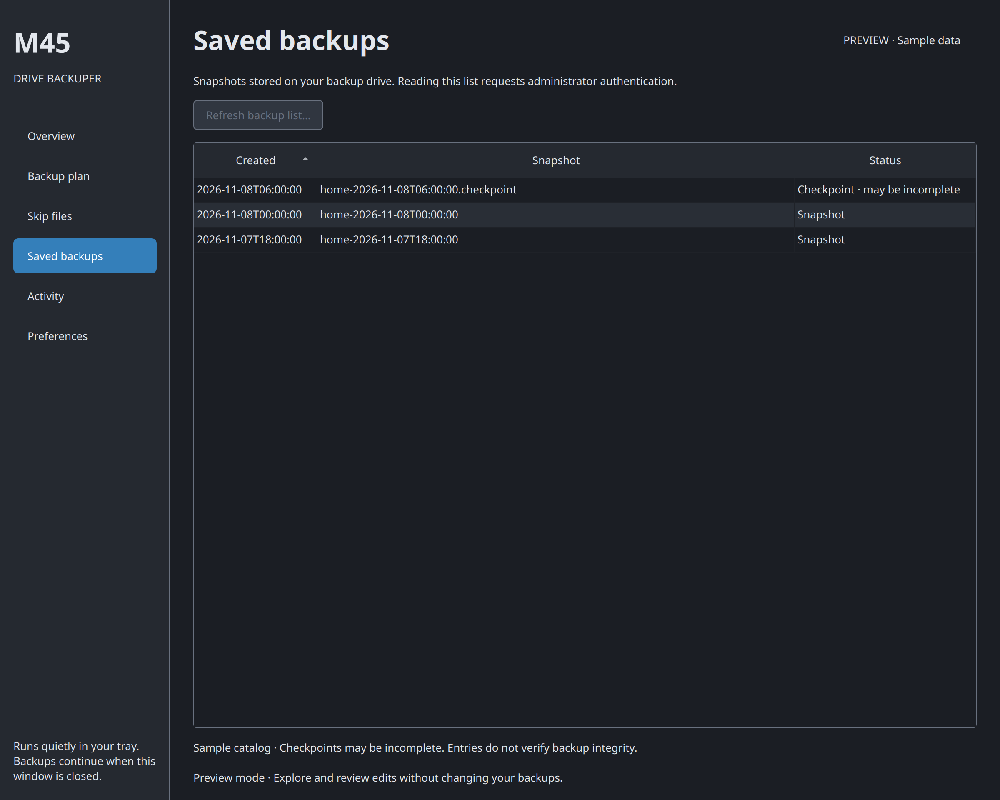
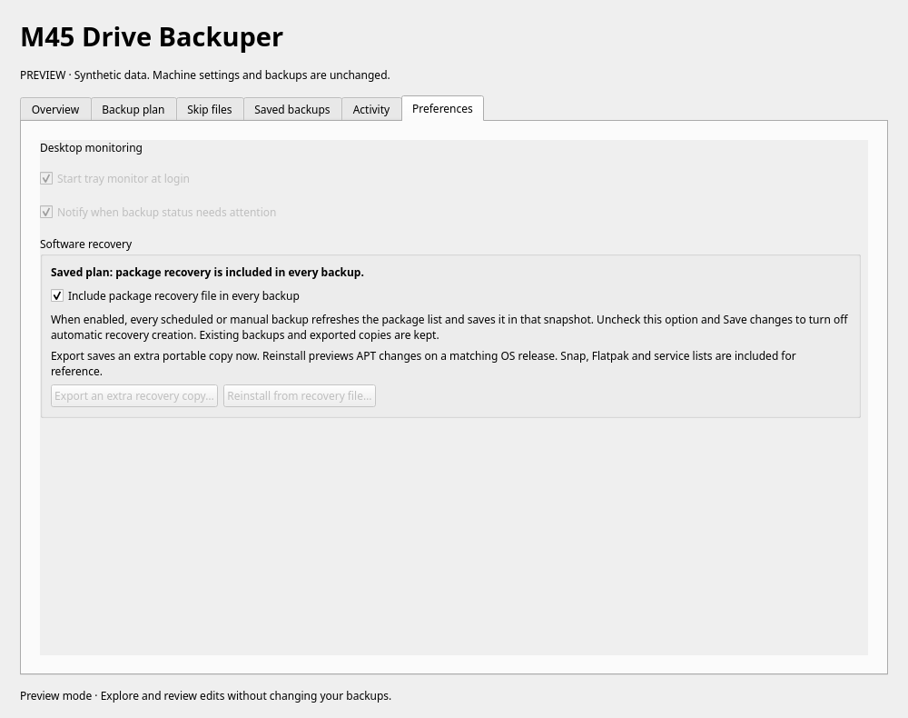

# M45 Drive Backuper

Licensed under the [MIT License](LICENSE).

A native Qt 6 KDE Plasma tray app for configuring and monitoring this machine's existing Borg backup job. Based on the DriveWatch project's native Qt window/tray structure, palette-aware presentation, single-instance D-Bus integration, XDG launcher/autostart, CMake build and Debian packaging. DriveWatch remains unchanged; its MIT attribution is retained in LICENSE.

## Screenshots

These are dark-mode captures of the actual Qt app using synthetic demo data. The app follows your desktop palette. The destination warning demonstrates a moved backup drive, rather than the state of a real machine. Click any image to view it at full resolution.

### Everything important, at a glance

Current status and its next action come first, followed by the next scheduled run, last attempt, and saved backup plan.

[](docs/screenshots/overview.png)

| Build your backup plan | Choose what to skip |
| :--- | :--- |
| [](docs/screenshots/settings.png) | [](docs/screenshots/exclusions.png) |
| Choose your source, destination, and schedule. Advanced options stay tucked away, and edits are reviewed before saving. | Search exclusions, skip files or folders, and include selected items again. Original files stay on disk. |

### Activity you can actually read

Local timestamps, severity icons, source labels, and wrapped messages make each event easier to follow. Search, filter warnings and errors, or switch to plain text for troubleshooting.

[](docs/screenshots/activity.png)

| Browse saved backups | Desktop and recovery preferences |
| :--- | :--- |
| [](docs/screenshots/backups.png) | [](docs/screenshots/preferences.png) |
| Inspect stored snapshots and distinguish checkpoints that may be incomplete. Listing snapshots does not verify their integrity. | Set login and notification preferences, manage package recovery, or export an extra recovery copy. |

## Features

- System tray status, click-to-open menu, backup shortcut, settings and journal.
- Persistent sidebar navigation keeps Overview, Backup plan, Skip files, Saved backups, Activity and Preferences in a stable order.
- Overview separates the current status and its next action from schedule, last-attempt and backup-plan details.
- Backup plan groups source, destination and schedule into three sections, with advanced options collapsed and a persistent edit/review bar.
- Native Qt controls and desktop palette colors support light and dark themes.
- Detects the existing backup filesystem at a different mount path. The user can choose its detected path and review the change before saving.
- Simple setup: choose what to back up, **A folder** or **This drive** as destination, and a schedule. Detailed options stay collapsed.
- The folder chooser supports **New Folder**, and you can type a new folder path. Drive selection shows the exact backup folder. Switching choices keeps your folder entry; drive lists refresh with status without replacing your edits.
- Incremental snapshots or a full file scan, five compression presets, a minimum free-space check and an optional repository data limit.
- A dedicated **Skip files** page: pick files or folders, search existing exclusions, and include selected items again. Comments and advanced Borg rules are preserved.
- Direct **Open K4DirStat** shortcut for finding large folders in the selected source, with installation instructions if unavailable.
- Backup mode, compression, storage limits, mounting and retention stay under Advanced. **Use recommended settings** chooses incremental snapshots, balanced compression, a 10 GiB preflight reserve, automatic mounting, system settings, software recovery lists, cache skipping and 4 hourly / 7 daily / 4 weekly / 6 monthly retention. Existing storage quotas and exclusions are preserved.
- Unsaved-change tracking, discard and review controls, and a quit warning protect unfinished edits.
- A sortable saved-backup catalog, checkpoint labels, and desktop preferences.
- Activity events with local timestamps, severity icons, source labels and wrapped messages. Search and a warnings/errors filter work across both the event table and a monospace plain-text view. Copy visible log preserves multiline output; journal access and truncation notices remain visible.
- Start a backup, enable/disable its existing timer, and read the repository archive catalog.
- Login startup toggle, attention notifications and Qt desktop colors.
- Read-only monitoring uses the desktop user's journal permissions. Administrative actions use `pkexec` with a root-owned fixed-purpose helper; the GUI never runs as root.

Opening or installing M45 Drive Backuper does **not** modify the backup script, schedule, exclusions, repository or mounts, and does not run a backup. All backup changes are explicit app actions. Settings saves show a review dialog, validate values and the destination UUID, reject changes during an active backup, save recovery copies under `/var/lib/m45-drive-backuper/settings-backups/`, and atomically replace each file. A failed save restores previous files. Schedule changes retain the existing boot trigger and randomized delay. Turning off the schedule allows an active run to finish.

This release adapts `/usr/local/sbin/local-system-backup`, `/etc/local-system-backup.exclude`, and `local-system-backup.{service,timer}`. It recognizes that script's current structure and refuses unsupported formats. The source can be a folder or a mounted filesystem; drive selections are UUID-checked again at backup time. Drives are backed up as files, not bootable disk images. Nested filesystems are skipped. The destination can be an empty local folder or a connected local drive. Drive selection uses a dedicated `M45-Backups` folder (or the existing repository on the already configured drive). Saving initializes an empty destination as an unencrypted Borg repository and marks it for this machine; unrelated nonempty folders are refused. Existing Borg repositories can be reused after verification, including a repository from a previous installation with a different machine ID; the review explains that its existing snapshots are subject to the selected retention policy. Old repositories are never deleted when switching destinations. The repository itself is excluded from backups. New repositories have owner-only access; the save review explicitly identifies their unencrypted storage. A failed settings save can leave an initialized repository ready for reuse. File recovery writes selected snapshot contents into a separate user-owned destination; it does not restore a bootable system, unlock encrypted drives, change encryption, or prune independently.

Incremental mode skips reading files that the file cache identifies as unchanged. Full file scan mode rereads every file with Borg's file cache disabled. Both create complete snapshots with deduplication; neither creates an independent disk image. Compression presets affect newly stored chunks, not existing backup data. “Skip marked cache folders” skips CACHEDIR.TAG-marked directories; explicit advanced exclusions still apply.

Storage limits are in GiB. “Leave free” is a preflight check after cleanup, not a guaranteed reserve during the backup. The storage limit controls Borg repository data, with metadata and temporary-space overhead possible; it is applied at the next backup. Choose “No limit” to remove the quota, “Keep existing limit” to preserve it, or “Limit backup storage to” for a specific cap. Settings saves show these options before requesting authentication.

## System settings and software recovery

**Also include system settings and local software** adds `/etc`, `/usr/local`, `/root`, `/var/spool/cron`, `/var/lib/dpkg`, `/var/lib/apt/extended_states`, `/var/lib/NetworkManager`, `/var/lib/bluetooth`, and `/var/lib/AccountsService` when present. These may contain passwords and private keys and inherit the selected repository’s encryption. Other data drives and service databases are outside this selection. Skip files also accepts paths in these additional sources.

**Include package recovery file in every backup** is visible in both **Backup plan** and **Preferences → Software recovery**. Both checkboxes edit the same setting; **Save changes** applies it. The saved-state message stays explicit while an enable/disable change is pending. When enabled, each backup refreshes `/var/lib/m45-drive-backuper/recovery/software-recovery.json` before archive creation. The recovery directory is included in that snapshot. The format follows the inspected M45 `restore-manifest` output convention: OS release, installed package versions, manual APT selections, held packages, Snap/Flatpak inventories, and enabled services/timers. Optional inventory failures are recorded as warnings rather than silently omitted. APT inventory failure stops the job before cleanup.

Under **Preferences → Software recovery**, **Export an extra recovery copy…** creates a separate portable JSON file. This export is optional; automatic backups already contain the recovery file when the saved setting is enabled. **Reinstall from recovery file…** validates the file and OS release/architecture, runs an APT simulation, and shows its details before administrator authentication and installation. It installs manual selections and their dependencies from the current repositories, without allowing package removals. Review repository sources and signing keys from the `/etc` backup first. Saved versions are reference information; unavailable third-party packages need their original repository or installer. Held-package, Snap, Flatpak, service and timer lists are for separate review and restoration; they are not automatically applied. The file contains inventory, not user data or package binaries. Cancellation before installation makes no package changes; a package-manager failure during installation may leave partial changes, which the app reports.

## Drive mounting and notifications

**Mount configured drives when needed** runs before source checks and backup cleanup. It uses existing `/etc/fstab` entries whose target and UUID match, verifies the UUID again after mounting, and refuses to mount over another filesystem. It supports a source folder on a recorded filesystem as well as a whole source drive. The drives must be connected, and encrypted volumes must already be unlocked. It does not create fstab entries or format disks. A new drive without a matching fstab entry can be used while mounted, but must be mounted through the desktop when disconnected. The tray’s **Mount backup drives** action also uses this path.

The tray shows running, completed, warning and error states. **Backup completed with warnings** uses an amber icon; failed attempts use a red icon and a critical notification. **Activity** shows Borg's actual warning/error messages separately from the full job output, including errors from cleanup commands. Repeated identical alerts are suppressed; a later attempt can notify again. Notifications also cover unavailable destinations or sources, low free space, disabled schedules and monitoring failures. They require the tray to be running and can be suppressed by desktop Do Not Disturb.

For an existing job, **Enable Borg warning and error reporting…** on Overview updates the saved script after authentication, preserving the selected plan. Saving any backup-plan change also installs reporting. The job uses Borg's `--log-json`, keeps warning exit status 1 and error statuses, and records a final result in the journal. Maintenance warnings allow archive creation to continue, then remain visible in the final result. Preflight failures and skipped/locked attempts are distinguished from completed backups. An existing systemd `OnFailure` alert also runs when the job exits with warnings; the app distinguishes that warning result from a fatal error. No service failure policy is changed.

Diagnostics are read only from the service's current invocation, so an earlier warning cannot contaminate a later success. The Activity view retains up to 500 journal entries and labels truncation. It preserves journal timestamps and shows them in your local timezone. Unknown timestamps are shown as a dash; plain output without an explicit severity is not guessed to be an error. The event table and plain-text view share search and severity filters; access errors remain visible even when no events match. Journal permissions/retention may limit detailed messages; the app does not claim that unavailable diagnostics prove a warning-free backup.

## Choosing what to skip

1. Choose a source folder or mounted drive in **Backup plan**.
2. Open **Skip files**. Existing exclusions are already listed, including advanced rules. The total rule count stays visible while searching, with a separate count of matching rows. Folder rules cover their contents, and a single pattern can exclude many folders. The marked-cache checkbox adds a separate rule beyond this count.
3. Use **Skip a folder…** or **Skip files…** to select unwanted data. A folder selection excludes that folder and its contents; a file selection matches that exact name, including characters such as `*` and `[`.
4. Use **Open K4DirStat…** to inspect large folders, then return to choose exclusions. K4DirStat is optional and runs as your desktop user. See the [K4DirStat manual](https://manpages.ubuntu.com/manpages/noble/man1/k4dirstat.1.html).
5. **Save changes…** shows a short plan summary and expandable technical details before authentication.

Excluding something affects future backups and does not delete the original. Removing a rule with **Include selected again** does not override other matching rules. Old snapshots retain their contents until retention removes them. A changed source can leave exclusions outside the selected source; those paths are labelled and retained. Custom rules and comments are preserved when using the pickers. Source paths through symlinks must be replaced by their resolved path so exclusion matching stays consistent.

## Install from the signed APT repository

Packages are built and tested on **Ubuntu 24.04, amd64**. Other distributions are not yet tested. The shared M45 Software repository also distributes Drive Watcher; if its setup package is already installed, skip the bootstrap steps and install Backuper directly.

```sh
sudo apt install curl ca-certificates
curl -fLO https://m45software.com/apt/m45-software-archive-keyring_1.0_all.deb
printf '%s  %s\n' '64c664ec99234f244ec051e945ff604d8390966ef0d47df28c3ee39edc3d0fd1' 'm45-software-archive-keyring_1.0_all.deb' | sha256sum -c -
sudo apt install ./m45-software-archive-keyring_1.0_all.deb
sudo apt update
sudo apt install m45-drive-backuper
m45-drive-backuper --show
```

The setup package installs `/usr/share/keyrings/m45-software-archive-keyring.asc` and `/etc/apt/sources.list.d/m45-software.sources`. The source uses `Signed-By` to scope trust to this archive. Signing-key fingerprint: **`F8BD 2FC4 4347 3EB7 1D87 003B F8A7 E75C 58D7 C0A3`**.

For later updates:

```sh
sudo apt update
sudo apt install --only-upgrade m45-drive-backuper
```

Quit the running tray app and reopen it after upgrading. Installation does not change your backup plan or start a backup. To remove the repository and its public key while keeping installed apps, run `sudo apt purge m45-software-archive-keyring`.

## Build, test and install

Requires CMake, C++17, Qt 6 Widgets/DBus development packages, Python 3, Borg 1.2, systemd and PolicyKit. Python tests use the distribution Python because it supplies Borg's pattern parser.

```sh
cmake -S . -B build -G Ninja -DCMAKE_BUILD_TYPE=Release -DCMAKE_INSTALL_PREFIX=/usr -DPython3_EXECUTABLE=/usr/bin/python3
cmake --build build --parallel
ctest --test-dir build --output-on-failure
(cd build && cpack -G DEB)
sudo apt install ./build/m45-drive-backuper_0.3.5_amd64.deb
m45-drive-backuper --show
```

The package adds an Applications menu entry and login autostart. No root background collector is needed: the app reads status asynchronously every 15 seconds. Install the package to use real monitoring/actions; the helper has a fixed installed path. Members of `adm` or `systemd-journal` can read the service journal. If journal access is restricted, the app reports that limitation; status is still available. Quitting the tray monitor does not affect system backups. Existing system failure notifications remain in place.

```sh
QT_QPA_PLATFORM=offscreen ./build/m45-drive-backuper --demo --page journal --screenshot build/activity-preview.png
```

Demo mode uses synthetic data. You can edit a plan, choose exclusions and review the result; it never invokes the helper, opens K4DirStat, saves preferences, registers the real D-Bus name, or sends notifications. Screenshot timestamps illustrate the sample failure rather than the current state of a machine.

GitHub Actions builds and tests each push and pull request and uploads the `.deb` as an artifact. A release commit on `main` whose message starts with `Release v` publishes a preview release with matching `docs/releases/vVERSION.md` notes and `SHA256SUMS`, then deploys that exact tested package to the signed APT repository. Manually published releases with matching assets also deploy; drafts do not. See [APT repository operations](docs/apt-repository.md) for the restricted receiver, dedicated deployment credential, immutable package versions, and backup coverage.

CI caches the downloaded Ubuntu packages listed in `.github/ci/apt-packages.txt`
and installs them without optional recommendations. APT still updates indexes,
resolves dependencies, and verifies packages. Daily cache keys include the runner
image, architecture, and dependency manifest; older matching caches seed new
keys. The first run fills the cache. C++ compilation uses a separate 250 MB
`ccache`, with hit/miss statistics in the build log. CMake configuration, tests,
and Debian packaging run normally. APT publication needs no development tools.

### Refreshing the README screenshots

The opt-in capture target renders all six pages with a consistent dark palette, Fusion style, Noto Sans font, local timezone, and 1200 × 960 logical window size. Use Noto Sans and your platform's normal monospace font for consistent typography. A scale factor of 2 produces sharp 2400 × 1920 PNGs for full-size viewing. The capture tool always uses demo mode and is not included in the installed app.

```sh
cmake --build build --target capture-screenshots --parallel
QT_QPA_PLATFORM=offscreen QT_SCALE_FACTOR=2 TZ=America/Denver ./build/capture-screenshots docs/screenshots
```

## Isolated backup test harness

Run this as your normal desktop user, without sudo:

```sh
/usr/bin/python3 tests/backup_harness.py
```

Each invocation creates a fresh directory under `build/backup-lab/run-*`. Existing runs are never overwritten. Use `--output /path/to/lab` to choose another parent directory. The laboratory contains a small **source files** tree, a real Borg repository at **destination/repository**, sample system settings, generated recovery JSON, a **restored** copy, generated shell scripts, per-run logs, and **REPORT.txt** / **report.json**. The sample package inventory contains fake package names; do not use it to reinstall software.

The harness uses the application's actual script adapter and recovery serializer, then executes the resulting shell job. Borg performs real creation, pruning, compaction, quota configuration, listing, extraction and `check --verify-data` operations. Checks cover selected/excluded data, changed and new files, historical snapshots, automatic recovery refresh, disabling recovery/system settings, restoring excluded data to future coverage, compression/full-scan settings, job-lock contention and early failure guards. A negative control deliberately omits recovery from an otherwise valid archive and verifies that our check catches it even when Borg's integrity check succeeds.

Mount UUIDs, free-space readings, package-manager inventory, archive timestamps and selected Borg failures/cleanup warnings are controlled test inputs. The create-warning scenario uses a genuinely unreadable sample file. No real mounts, systemd actions, authentication, package installations, installed helper calls or live backup configuration changes occur. The separate Qt tests verify Overview/Activity messages, warning versus critical notification requests, duplicate suppression and clearing old diagnostics. Desktop notification delivery and physical drive handling need separate desktop/VM checks. The shell fixture in `tests/fixtures/local-system-backup.sh` represents the supported legacy job; the actual adapter upgrades its warning handling before execution. It is never copied from a user's live job at test time.

The former warning-to-success gap is now a required regression check: Borg warning **1** must remain job warning **1**, and its message must survive parsing. Cleanup warnings/errors, fatal create errors, skipped runs and a later clean run are also checked. Every gap returns failure; `--strict` remains accepted for compatibility and is used by CTest. `--temporary` removes its run directory after reporting; omit it when you want to inspect artifacts. No data from the real backup repository is used.

## Browse saved files and recover selections

Under **Saved backups**, choose **Browse latest backup…** to go straight to
the latest completed snapshot. To choose an older snapshot, refresh the backup
list, select its row, and choose **Browse selected backup…**. One administrator authentication opens a
browser session for that snapshot. The first browse builds a metadata-only
index and reports progress; subsequent folder navigation uses that cache.
The browser starts at the backed-up source folder when present. **Backup root**
exposes the other saved source areas, and **Up** navigates to a parent.

Filter names within the current folder, navigate by double-clicking folders,
and select files or folders. Large folders are paged in groups of 500; filters
search the whole current folder, not just its visible page. Non-text filenames
use escaped display names while preserving their exact byte paths internally.
Checkpoint snapshots are not offered as completed backups.

**Recover selected…** reviews the selected items and destination. The default
is `~/Recovered Files`; another destination can be typed or chosen. Every run
creates a fresh timestamped subfolder there. Selected items appear immediately
inside that new folder, preserving the directory structure below the browsed
folder. Existing output and live source files are not overwritten. **Open
recovered folder** opens the result in the desktop file manager.

Borg reads/exports only the selected file or folder contents under the existing
backup job lock. Backups wait during recovery; starting recovery while a backup
or check owns the lock is refused until that job finishes. Browsing cached
metadata holds no backup lock. Snapshot ID, filesystem UUID, saved-plan revision
and selected paths are validated before recovery. A pruned snapshot is reported
unavailable. Automatic mounting, if enabled, mounts only the destination for
recovery; the original source drive need not be available.

The privileged browser reads the root-owned repository, but extraction runs as
the authenticated desktop user with that user's normal groups. Recovered files
belong to that user inside a private new folder. Tar extraction uses Python's
safe data filter, drops ownership/setuid metadata, and skips unsafe links and
special files. This is file-content recovery rather than full system metadata
restoration. Recover sensitive system files into the private output folder and
review them before copying them elsewhere.

The browser shows progress and remains open while an operation is running. A teal animated
download icon identifies recovery or catalogue reading in the tray, so a
backup waiting for recovery is not shown as actively backing up.
Interrupted, skipped or failed entries produce an incomplete-recovery result;
partial files are retained and can be opened. No automatic retry writes over
that output. Metadata indexes are root-only, disposable, and limited to three
recently used snapshots. Opening the first recovery session also installs the
same fixed backup-serialization hook used by verification, retaining a recovery
copy of the previous script. It does not enable automatic checks or change the
backup schedule.

## Backup checks

Under **Saved backups → Backup integrity**, the defaults are **Manual only**
and **Most recent completed backup only**. Opening or installing the app does
not start a check or enable its timer.

**What to check** offers the latest completed snapshot or the whole repository.
**Check now…** uses the selected scope for that manual run. To check a specific
completed snapshot, refresh the backup list, select its row, and choose
**Check selected backup…**. Selection uses the archive ID and is validated
again when the check runs; a pruned snapshot is reported unavailable rather
than silently checking another one. Checkpoints are not eligible as completed
backups. Latest selection uses Borg timestamp ordering and skips checkpoints.

Snapshot checks use `borg extract --dry-run`, which reads metadata and file
chunks, checks hashes/HMACs, and decompresses/decrypts as needed, without
restoring files. An isolated temporary working directory provides additional
separation from live files. This verifies the data needed to read the chosen
snapshot; it does not verify repository-wide structure or data retained only
by older snapshots. Unchanged data shared with other snapshots still needs to
be read. A latest-snapshot check is not just a check of newly added files.

Whole-repository checks use `borg check --verify-data`, including repository
structure, stored data and all archives. Simply adding `--last 1` to that
command would not avoid its repository-wide data verification, which is why
snapshot checks use the distinct dry-run read path. Both scopes can take hours.
Neither scope repairs data or proves the intended sources/exclusions cover
every file; dry-run reads do not test writing restored files to a destination.

**When to check** offers manual only, after every completed backup, daily at
03:00, Sundays at 03:00, or the first of each month at 03:00. **Save check
options…** reviews and saves both timing and scope. A manual run does not
change the saved automatic settings. Times are local with up to ten minutes
of randomized delay. The persistent systemd timer catches missed scheduled
checks after the machine returns. Manual and after-backup modes disable that
timer. Existing timing-only settings adopt the latest-snapshot default.

After-backup checks are queued after clean backups and completed backups with
warnings, never after fatal creation failures. Verification does not replace
the backup job's outcome. The first explicit check action installs a fixed
completion hook in the supported backup script and changes its lock to wait
behind verification, retaining a root-only copy of the prior script. Backup
plan saves preserve the hook. Unsupported scripts are refused.

Checks continue with the app closed. Checks and backups share the job lock;
busy checks defer and retry in five minutes, while backups wait during an
active check. Manual selections are kept in a root-only runtime request file,
validated against the saved backup identity/revision, consumed once, and
expire after an hour rather than unexpectedly targeting a different backup.
**Stop check…** stops without recording an unfinished check as successful.

The app retains the latest attempt, its scope/snapshot, the last successful
check, and the last whole-repository success separately. A successful snapshot
check never advances the whole-repository verification date. Results survive
reboots and are scoped to repository, filesystem UUID and source. Check details
include bounded Borg output. The expected backup filesystem must be mounted;
the existing auto-mount setting applies. Authentication is required to start or
stop checks, read the snapshot catalog, or save options.

During active work, the tray icon animates: a blue upload arrow for a running
backup and a purple magnifying glass for a running check. The status and
hover tooltip name the active operation. If a backup waits behind a running
check, the check animation remains visible. Queued/deferred checks are
labelled separately and do not animate as if data were being checked.

## Interpretation and limitations

The service's latest result is an attempt result, not proof of a valid or recent archive. Jobs that have not yet enabled the new reporting retain their previous warning handling; Overview offers the update. The archive tab reads stored archive names/timestamps on demand with administrator authentication and a short Borg lock wait. Checkpoint archives may be incomplete. Integrity verification is a separate opt-in action under Saved backups; no live percentage is provided. Backup completion alone does not certify integrity. The script emits statistics after its runs. Root authentication may be cancelled without changing anything.

Retention settings can delete old archives on a future backup. Copies of old settings cannot recover deleted archives. Settings files are replaced individually; rollback handles ordinary errors but cannot provide a filesystem-wide transaction across a power loss. An already-open Settings editor is not overwritten by status polling; reopen the app to load external edits before saving.

Remove with `sudo apt remove m45-drive-backuper`, then quit the tray monitor. This preserves the existing backup system and per-user startup/preferences.

Implementation references: [Qt system tray](https://doc.qt.io/qt-6/qsystemtrayicon.html), [Borg archive listing](https://borgbackup.readthedocs.io/en/1.2.8/usage/list.html).

Login startup uses `--autostart` and stays in the tray by default. Enable **Open window at login** in Preferences to show the window automatically. Applications-menu launches open the window; a repeated login launch does not raise an existing window unless requested.

The monitor saves observed completed attempts and their diagnostics in `$XDG_STATE_HOME/m45-drive-backuper/last-attempt.json` (normally `~/.local/state/`). After reboot, those details remain visible until a new attempt starts. History is specific to the source and backup repository. Missing history is a neutral waiting state, not a backup failure.

### Reminder-only use

Preferences → Reminders for manual runs offers independent backup and integrity-check reminders: off (default), every day, every week, or every 30 days. These preferences are saved immediately for the current desktop user and never change the system's backup or check schedules.

For reminder-only backups, disable the automatic schedule on Overview. For reminder-only checks, save Manual only in Saved backups. Reminders pause while automatic runs are enabled, and wait during a backup, check, or file recovery. A notification opens the app; starting the job remains a manual action.

The interval runs from the last known successful run, or from enabling the reminder when no success is known. Backup successes come from observed Borg job results; integrity successes come from the saved check history (whole-repository reminders use the last whole-repository success). Failed, skipped, warning, or interrupted runs do not reset the interval. History is kept per backup source and repository, with separate state for check scopes. Changing a reminder interval starts fresh state and uses any currently available success history.

The tray monitor must be running, with desktop notifications permitted. It catches up on overdue reminders after login or reboot, with at most one reminder per task per day until a successful run. Turning off status-warning notifications does not disable separately opted-in reminders. Quitting the monitor stops reminders until it runs again. Reminder settings do not enable login startup automatically.

### Cancel, pause, or postpone a run

Both Overview (backups) and Saved backups (checks) have run controls, also available from the tray. Running or temporarily held jobs expose Pause/Resume and Cancel directly in the tray and main window. The controls menu offers postponement for 1, 4, or 24 hours, an indefinite pause of future runs, and a one-day reminder snooze when that reminder is enabled.

- **Cancel** stops the managed service and any Borg children, including queued retries. A paused job is thawed for termination. Incomplete runs do not count as successful. Cancelling a postponed run removes the one-time request; normal schedules are kept.
- **Pause** freezes the whole running service and its descendants using the Linux cgroup v2 freezer, preserving its live process state. Resume continues that same run. Keep its drives connected; its repository lock remains held, so other operations can wait. Pausing with no job running gates future starts until Resume.
- **Postpone** freezes a running job and resumes it at the displayed time. With no job running, it gates automatic starts and requests one new run at that time, using the saved plan/check scope. This is an explicit one-time automatic run, even if regular schedules are off. The monitor can be closed; a system timer processes postponements about every 30 seconds. Changing the backup plan cancels a pending new run. A paused process cannot survive reboot: a timed postponement of an existing process clears at its due time without resurrecting that old process. A postponed new run is retained across reboot.

Administrator authentication is required for job controls. They target only the two fixed managed services, validate the current plan and invocation to reject stale clicks, and never invoke Borg repair. Pause requires a running service with a cgroup v2 freezer; it is unavailable during stopping or where the freezer is unsupported. The housekeeping timer is enabled only on explicit pause/postpone use; installation alone does not enable it.

Implementation references: [Linux cgroup v2 freezer](https://docs.kernel.org/admin-guide/cgroup-v2.html#core-interface-files) and [systemd service conditions](https://www.freedesktop.org/software/systemd/man/255/systemd.service.html#ExecCondition=). `tests/job_control_harness.py` is an optional root-only smoke test that creates and removes disposable systemd services to validate freezing both parent and child processes, resume, timed resume, and cancellation without accessing backup data.

### Wait until idle for automatic jobs

Preferences → Wait until idle before automatic runs offers separate opt-ins for backups and integrity checks. The maximum delay defaults to **6 hours**, with 12, 24, and 48 hours also available. Both opt-ins default off, leaving existing schedules unchanged.

An automatic run starts when all user login sessions have reported idle for ten minutes, or at its maximum-delay deadline even if the system is still in use. The deadline begins with the first deferred trigger; repeated triggers do not extend it. This uses [systemd-logind idle hints and monotonic idle timestamps](https://www.freedesktop.org/software/systemd/man/255/org.freedesktop.login1.html), rather than CPU utilization. Returning to work after a run starts does not pause it automatically.

When idle reporting is unavailable, idle waiting is disabled and its UI controls are greyed out with an explanation. Jobs then follow their normal schedules, and already-waiting jobs are released on the next housekeeping tick. A valid busy report is distinct from unavailable reporting. No logged-in user sessions counts as idle. Unsupported session types, missing/invalid idle data, failed queries, and query timeouts disable waiting rather than holding jobs.

Waiting jobs appear in the main window and tray with their latest start time and Run now / Cancel actions. They hold no Borg repository lock while waiting. Manual starts, Run now, and explicit timed postponements bypass idle waiting. The housekeeping timer processes waiting jobs about every 30 seconds and works with the monitor closed. Waiting state survives a reboot; a changed backup plan or changed check options cancels stale requests. Reducing the maximum delay shortens an existing wait; increasing it never extends that request's deadline. Turning off the idle-wait option releases pending jobs. Disabling the relevant automatic schedule removes its idle-wait request.

These controls require administrator authentication when saved, apply machine-wide to the managed services, and do not change saved backup or verification schedules. Saving an opt-in enables the housekeeping timer. Installation alone does not enable idle waiting or that timer.
